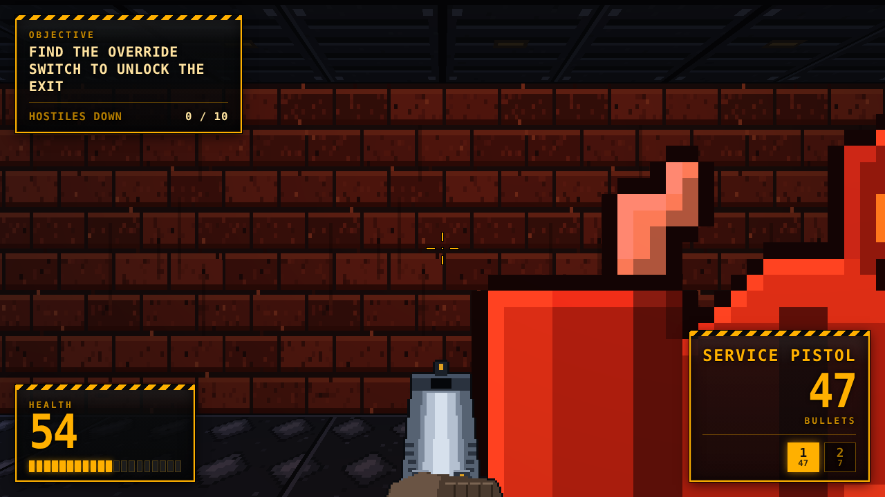
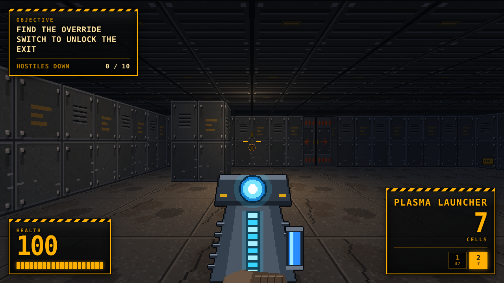
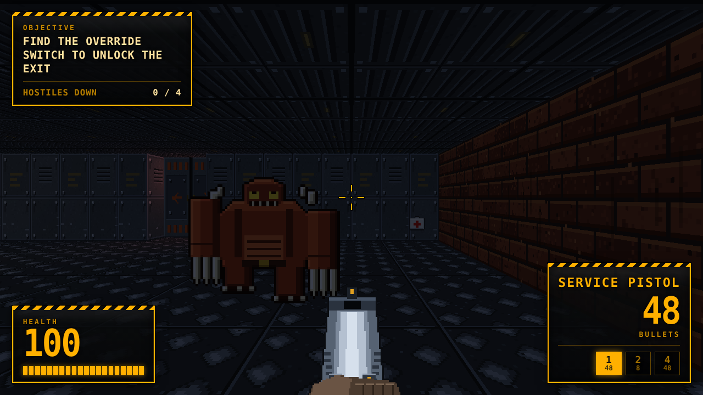
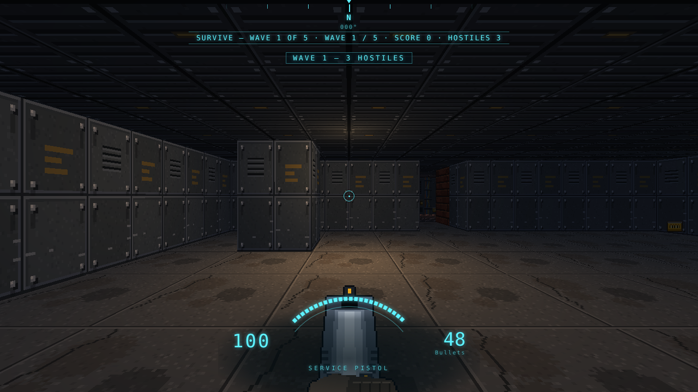

<div align="center">

# BULKHEAD

**A modular, plugin-driven, Doom-inspired 2.5D first-person shooter foundation, and the playable game built on it.**

[](https://github.com/mojomast/fpsrizz/actions/workflows/ci.yml)


### [▶ Play it in your browser](https://mojomast.github.io/fpsrizz/)



</div>

---

## Why this exists

Most hobby shooters are a single tangled game loop. Bulkhead is the opposite: a **small runtime kernel** that knows nothing
about shooters, plus **plugins** for everything else. The reference game ("Bulkhead Station") is made only of plugins that
use the same public SDK a third party would use, so adding a weapon, an enemy, a HUD or a whole game mode never means
editing the engine.

- **Three layers.** Runtime kernel (scopes, ECS, fixed-step scheduler, typed registries, command and event buses, plugin
  host) → platform adapters (rendering, input, audio, storage, UI) → gameplay plugins and content packs.
- **Safe by construction.** Manifests are validated before any plugin code is imported. Registration and content run in
  staged registries and are committed only if everything validates, so a bad preset leaves the running game untouched.
- **Clean restarts.** Every resource is owned by a scope and disposed in reverse order. The browser test applies 12
  preset switches and 12 restarts and asserts that owned-resource counts never grow.
- **Two kinds of extension.** Trusted code plugins, and data-only JSON content packs with semantic validation.
- **Zero runtime dependencies.** Even the WebGL2 renderer is in the repo.

## Screenshots

| | |
|---|---|
|  **Start screen** with controls and active preset |  **Projectile weapons** and hitscan |
|  **Extension: ricochet rifle** (new attack behaviour plugin) |  **Extension: data-only pack** (new map, brute enemy, scattergun) |
|  **Extensions: survival mode + replacement HUD** |  **Creator panel**: plugins, presets, import/export, debug |

## The four extension proofs

Each is a preset you can switch to live from the creator panel (press `` ` ``):

| Extension | Kind | What it demonstrates |
|---|---|---|
| `example/pack` | Data-only JSON pack | New weapon, enemy, pickup and map with **zero code** |
| `example/ricochet` | Code plugin | A new attack behaviour registered through the SDK, used by a weapon defined in data |
| `example/hud` | Code plugin | A complete replacement HUD that fully removes the original |
| `example/survival` | Code plugin | A different game mode (waves, score, win and lose) using only public services |

> **Stack deviation: read this first.** The original brief asked for Three.js + Vite + Vitest. This build was produced
> in an environment with no network access to the npm registry, so none of them could be installed. Instead:
>
> - **Rendering** uses *mini3* (`src/platform/render/mini3`), an in-repo WebGL2 renderer that mirrors a subset of the
>   Three.js API (same class and property names). It sits behind the render adapter
>   (`src/platform/render/service.ts`) and the rendering SDK (`src/sdk/render.ts`, exported there as `THREE`).
> - **Bundling and dev server** use esbuild (`scripts/build.mjs`, `scripts/dev.mjs`).
> - **Tests** use Node's built-in runner (`node --test`), executing TypeScript directly (type stripping, Node >= 22.18).
> - **Type checking** is a separate `tsc --noEmit` (TypeScript 7).
> - There are **no runtime dependencies**.
> - Development dependencies are locked in `package-lock.json` for reproducible installation.
> - Dev tools (esbuild, Playwright) are resolved by `scripts/tools.mjs` from the project's `node_modules`, then from
>   `TOOLS_NODE_MODULES`, then `/opt/npm-tools/node_modules`. `tsc` is taken from `node_modules/.bin` or the `PATH`.
>
> Moving to real Three.js + Vite + Vitest is a contained change; see [ARCHITECTURE.md](ARCHITECTURE.md) (mini3 section)
> and [devplan.md](devplan.md).

## Quick start

Play online: **https://mojomast.github.io/fpsrizz/** (served from the `gh-pages` branch).

Or run it locally (Node >= 22.18):

```bash
npm ci             # install locked devDependencies
npm run dev        # dev server at http://127.0.0.1:5173/ (refresh after rebuild)
```

Changes to files in `public/` require restarting the dev server.

Production build and local preview:

```bash
npm run build      # writes dist/
npm run preview    # serves dist/ at http://127.0.0.1:4173/
```

## How to play

Click **Play** on the start screen; the browser captures the mouse (pointer lock).

**Objective:** find the override switch, then reach the green exit pad. The switch is on the north wall of the
control room (north-east of the arena). Using it unlocks the exit gate that seals the exit chamber (south-east). You
lose if your health reaches zero. Doors open and close with the Use key; the exit gate only opens through the switch.

| Action | Input |
|---|---|
| Move forward / back | `W` / `S` (or `Up` / `Down` arrow) |
| Strafe left / right | `A` / `D` |
| Aim (yaw only) | Mouse; `Left` / `Right` arrow keys also turn |
| Fire | Left mouse button or `Space` |
| Use (open door, flip switch) | `E` or `F` |
| Select weapon | `1` to `5` (weapon slot number) |
| Next weapon | `Q` or mouse wheel down |
| Previous weapon | Mouse wheel up |
| Release mouse and pause | `Esc` |
| Creator tools panel | `` ` `` (backquote) |

Mouse sensitivity, volume and render quality (pixel-ratio cap) are on the start and pause screens. The start screen lists
the active preset, the objective, the controls registered by the enabled plugins, and any enabled extensions.

## Presets and extensions

The presets in `src/content/presets/` include the reference game, extensions and genre slices. The first is the default.

| Preset | Adds | Where it lives |
|---|---|---|
| Bulkhead Station — Objective (`core/default`) | The reference game | `src/plugins/core-*`, `theme-industrial` |
| Bulkhead Station — Extended arsenal (`example/extended`) | Scattergun (slot 4, data pack) and Ricochet Rifle (slot 3, new attack behaviour) | `example/pack`, `example/ricochet` |
| Bulkhead Annex — content-pack map (`example/annex`) | The Annex map, Brute enemy and scattergun from the data pack | `example/pack` |
| Survival — waves, Visor HUD (`example/survival`) | Wave-survival mode and visor HUD, plus the weapons above | `example/survival`, `example/hud` |
| Bulkhead Station — Assetrizz (`theme/assetrizz-demo`) | Reference game with Assetrizz tiles/enemies and Blender weapon renders | `theme/assetrizz` |
| Time Trial Raid (`example/time-trial`) | Find the override and escape before the deadline | `example/time-trial`, `theme/assetrizz` |
| Arena Score Attack (`example/arena-score`) | Score kills against respawning enemies; Shift sprints and Ctrl dashes | `example/arena`, `example/dash-controller`, `theme/assetrizz` |
| Silent Observatory (`example/observatory`) | Noncombat switch hunt and escape | `example/adventure-pack`, `theme/assetrizz` |
| Blackout Ward (`example/blackout`) | A darker objective map with scarce supplies and two hostiles | `example/adventure-pack`, `theme/assetrizz` |
| Holdout (`example/holdout-game`) | Reach and defend the exit zone while enemies spawn | `example/holdout`, `example/dash-controller` |
| Key Dungeon (`example/key-dungeon-game`) | Find a key, unlock the gate, and escape | `example/keys`, `example/key-dungeon` |
| Silent Relay (`example/silent-relay-game`) | Avoid stationary guards, activate the override, and escape | `example/stealth`, `example/stealth-map` |
| Seeded Gauntlet (`example/gauntlet-game`) | Clear three encounters and receive automatic run-only upgrades | `example/roguelite` |
| Foundry Circuit (`example/foundry-race`) | Drive through checkpoints in order before time expires; W accelerates, S brakes/reverses, A/D steer | `example/racing`, `example/race-track` |
| Salvage Run (`example/salvage-game`) | Collect loot and extract before the timer expires | `example/extraction`, `example/extraction-map` |
| Relay Station (`example/relay-tactical`) | Objective combat with a magazine-fed carbine; 3 selects it and R reloads | `example/tactical-pack` |

To switch: press `` ` `` (or use **Creator tools** on the start or pause screen), open **Plugins & preset**, pick a preset
in the **Load** dropdown, then press **Apply & restart**. The selection is saved in `localStorage` and restored on the
next page load. Plugins can also be toggled individually, and content packs imported, from the same panel. See
[PLUGINS.md](PLUGINS.md) and [CONTENT_FORMAT.md](CONTENT_FORMAT.md).

## Project layout

```
src/
  kernel/      Runtime kernel: plugin host, registries, entity store, event/command buses, scheduler, scopes, validation.
               Knows no game concepts and touches no DOM.
  sdk/         Public plugin API: core.ts (generic host surface), contracts/ (shared shooter vocabulary), render.ts.
  platform/    Browser adapters: input, audio, storage, UI mounting, flow service, render host and the mini3 renderer.
  app/         Composition root: main.ts (frame loop), catalog.ts, shell.ts (menus), creator.ts (creator panel).
  plugins/     Reference game, theme and the four extension demonstrations (one folder per plugin or content pack).
  content/     Presets (presets/*.json).
scripts/       build, dev, preview, smoke test, boundary checker, plugin scaffolder, tool resolution.
tests/         node:test suites and helpers; subfolders with browser demo scripts (run manually, not by npm test).
templates/     plugin-starter, used by npm run new-plugin.
public/        Static files copied into the build, including curated Assetrizz source images and provenance.
index.html     Page shell.
```

## Commands

| Command | What it does |
|---|---|
| `npm ci` | Installs locked devDependencies (esbuild, Playwright, TypeScript). |
| `npm run dev` | esbuild watch build and server at `127.0.0.1:5173`; `-- --port N` changes the port. |
| `npm run build` | Bundles `src/app/main.ts` into `dist/` (minified ES2022 plus source map). |
| `npm run preview` | Serves `dist/` at `127.0.0.1:4173`; `-- --port N` changes the port. |
| `npm run typecheck` | `tsc -p tsconfig.json --noEmit`. |
| `npm run lint` | Import-boundary checker (`scripts/boundaries.ts`). |
| `npm test` | Node unit and integration tests, including tooling tests. |
| `npm run smoke` | Browser acceptance run against `dist/` (headless Chrome, software WebGL2). Run `npm run build` first. Uses `/usr/bin/google-chrome` if present, otherwise Playwright's Chromium (`npx playwright install chromium`); set `CHROME_PATH` to override. Writes screenshots and `smoke-report.json` to `.smoke/`. |
| `npm run check` | `typecheck`, `lint` and `test` in sequence. |
| `npm run new-plugin -- <ns/name> ["Name"]` | Scaffolds `src/plugins/<ns>-<name>/` from the starter template. |
| `npm run validate-game -- <preset.json> [--pack <pack.json> ...]` | Stages a preset against the app catalog and optional wrapped JSON packs; use `--bundled` to validate shipped presets. Does not activate or play the game. |

### Assetrizz art

The Assetrizz preset bundles five pinned dark-sci-fi tiles, two enemy sprite strips and two generic Blender weapon
renders; remaining art and synthesized sounds derive from the industrial theme.
The Key Dungeon preset selects a fantasy Assetrizz theme with its own tiles, enemy strips and Blender weapon renders.
To regenerate the synchronous theme painters from the pinned upstream catalog and images, use Python 3 with Pillow:

```bash
python3 scripts/assetrizz.py import
# Or use an existing checkout at the pinned revision:
python3 scripts/assetrizz.py import --library /path/to/assetrizz
python3 scripts/assetrizz.py search /path/to/assetrizz/assets/manifest.jsonl enemy
```

The tool verifies the pinned manifest and PNG hashes. `scripts/assetrizz.json` records the selected keys and provenance;
the shipped images and upstream license note are in `public/assetrizz/`. Search requires the pinned manifest, and
the generated game assets need no network connection at runtime. After changing files in `public/`, restart the dev server.

## Supported environment

- A browser with **WebGL2** and **pointer lock**. Web Audio is used for sound; without it the game runs silently.
  The repository's browser checks drive Chrome only.
- **Node >= 22.18** for tooling (`engines` in `package.json`).
- Opening the page with `?test` removes the pointer-lock requirement so automated browsers can drive the game (see
  [ARCHITECTURE.md](ARCHITECTURE.md)). `window.__bulkhead` is a debugging and automation handle used by the smoke script;
  it is tooling, not part of the plugin API.

## Documentation

| File | Contents |
|---|---|
| [SPEC.md](SPEC.md) | Implemented scope, limitations, extension boundaries, asset provenance. |
| [ARCHITECTURE.md](ARCHITECTURE.md) | Layers, ownership model, lifecycle, simulation and rendering design, key decisions. |
| [PLUGINS.md](PLUGINS.md) | Public SDK and plugin authoring guide with API reference. |
| [CREATE_GAME.md](CREATE_GAME.md) | End-to-end game, content and plugin authoring workflow. |
| [GAME_PLUGIN_ROADMAP.md](GAME_PLUGIN_ROADMAP.md) | Proposed reusable mechanics, game recipes and engine prerequisites. |
| [BUILD_ORDER.md](BUILD_ORDER.md) | Cross-genre implementation dependencies and acceptance gates. |
| [assets/weapons/README.md](assets/weapons/README.md) | Low-poly weapon sets, source models, previews and integration notes. |
| [CONTENT_FORMAT.md](CONTENT_FORMAT.md) | JSON formats: manifests, content packs, maps, presets. |
| [devplan.md](devplan.md) | Milestone status and next steps. |
| [AGENTS.md](AGENTS.md) | Guidance for coding agents working in this repository. |
| [HANDOFF.md](HANDOFF.md) | Verification results and open items. |

## Testing and verification

`npm run check` runs the strict type check, import-boundary lint and Node tests. After `npm run build`, `npm run smoke`
plays the real game in headless Chrome, including gameplay, restart, extensions and resource counts. The creator panel
has its own browser test (`node tests/creator-demo/run.mjs`), which builds its own bundle. Both write to `.smoke/`.
CI runs check and build; it does not run either browser suite. Browser performance depends on the available renderer.
Run `node tests/genre-demo/run.mjs` after a build for browser startup, HUD and control checks on the new genre presets.

## Known limitations

Stated plainly; the full list is in [SPEC.md](SPEC.md) and [HANDOFF.md](HANDOFF.md).

- Rendering uses the in-repo *mini3* renderer, not Three.js (see the box above).
- GPU performance has not been measured; the only numbers are from software rendering in headless Chrome.
- Pointer lock and audio were not exercised by automation. Try them by hand.
- Imported content packs live in memory only, and there are no save games.
- Code plugins are discovered at build time and are trusted; there is no sandbox.
- The default theme uses procedural placeholder art and sound. Each Assetrizz theme replaces five tiles, two enemy
  sprites and the pistol and launcher views with bundled images; other Blender weapons are not yet wired into gameplay.

## Contributing

Read [AGENTS.md](AGENTS.md) for conventions and [PLUGINS.md](PLUGINS.md) to write a plugin
(`npm run new-plugin -- my/plugin "My Plugin"`). Keep `npm run check` green. See [CONTRIBUTING.md](CONTRIBUTING.md).

## License

[MIT](LICENSE)
