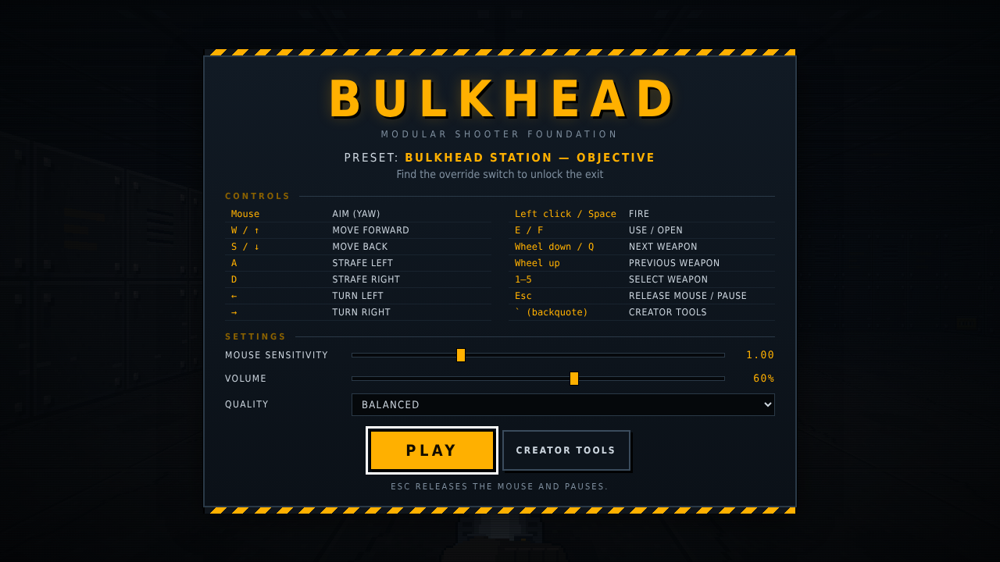
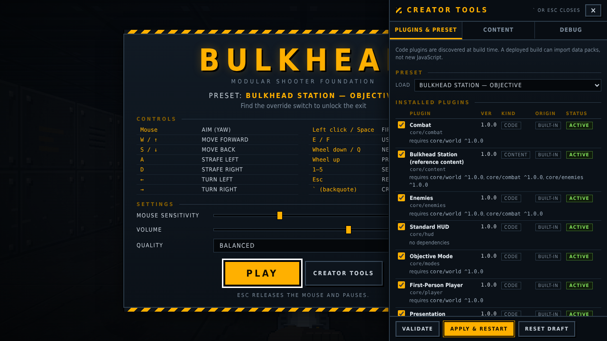

<div align="center">

# BULKHEAD

**A modular TypeScript game platform with a shooter, racing, tactics, adventure, and 3D games that share reusable mechanics across genres.**

[](https://github.com/mojomast/fpsrizz/actions/workflows/ci.yml)


### [▶ Play it in your browser](https://mojomast.github.io/fpsrizz/)

**Direct:** [Hollowmere metroidvania](https://mojomast.github.io/fpsrizz/?preset=hollowmere/ascent) · [Cinder Vault](https://mojomast.github.io/fpsrizz/?preset=cinder/vault) · [Bulkhead Station](https://mojomast.github.io/fpsrizz/?preset=core/default)


</div>

---

## Why this exists

Most hobby shooters are a single tangled game loop. Bulkhead is the opposite: a **small runtime kernel** that knows nothing
about shooters, plus **plugins** for everything else. The reference game ("Bulkhead Station") is made only of plugins that
use the same public SDK a third party would use, so adding a weapon, an enemy, a HUD or a whole game mode never means
editing the engine.

- **Three layers.** Runtime kernel (scopes, ECS, fixed-step scheduler, typed registries, command and event buses, plugin
  host) → platform adapters (rendering, input, audio, storage, UI) → gameplay plugins and content packs.
- **Safe by construction.** Manifests are validated before any plugin code is imported. Registration and content run in
  staged registries and are committed only if everything validates, so a bad preset leaves the running game untouched.
- **Clean restarts.** Every resource is owned by a scope and disposed in reverse order. The browser test applies 12
  preset switches and 12 restarts and asserts that owned-resource counts never grow.
- **Two kinds of extension.** Trusted code plugins, and data-only JSON content packs with semantic validation.
- **Contained rendering backend.** Official Three.js is pinned and reproducibly vendored behind the rendering SDK;
  plugins use the SDK and keep their import boundaries.

## Independent game experiences

Open **Creator tools → Load**, select a preset, then **Apply & restart → Play**.

| Experience | Defining loop | Controls and guide |
|---|---|---|
| **NEON RUN — Circuit Trial** | Accelerate, brake and drift a visible car through two ordered laps | W/S or ↑/↓, A/D or ←/→, Space to drift; [racing guide](docs/overhead-racing.md) |
| **Signal Break — Turn Tactics** | Select a squad member, preview moves/attacks, spend AP, then end the turn | Cursor or keyboard, M/A for action mode, E to end turn; [tactics guide](docs/turn-tactics.md) |
| **The Last Light** | Explore three rooms, talk to the keeper, combine items and restore a beacon | Click or Tab/Enter; explicit chapter Save/Load; [adventure guide](docs/narrative-adventure.md) |
| **Stonewake — 3D puzzle** | Push boulders onto seals, block pursuing golems and escape three volumetric chambers | WASD/arrows to step, Space to wait, Z undo, R retry, Q/E orbit; [Stonewake guide](docs/stonewake.md) |
| **Sky Salvage — 3D courier** | Fly between floating islands, recover cargo and supply matching beacons while avoiding a storm drone | WASD/arrows or held direction buttons, E collect/deliver, Space boost, F repair; [flight guide](docs/sky-salvage.md) |
| **Ember Bastion — 3D tower defense** | Spend scrap on towers, defend three waves, repair the core or trigger a pulse | Click 3D pads or numbered buttons, then Launch wave; [defense guide](docs/ember-bastion.md) |
| **Verdant Relay — 3D colony restoration** | Balance water, biomass and charge to restore three relays before drought or the season ends | Select a station in 3D or its button, then collect, convert, restore or wait; [colony guide](docs/verdant-relay.md) |

Each consists of independent simulation, presentation, authored content and theme plugins. None enables the shooter
player, world, combat, enemies, content pack, HUD or presentation. Racing and tactics use their own camera/board
presentation; adventure uses illustrated DOM scenes, while Stonewake has lit 3D meshes, an orbiting orthographic camera
and ray-picked floor controls. These games run with a free cursor or keyboard policy, without
pointer lock. The original first-person presets retain captured mouse aiming.

### Mechanics shared across genres

**[HOLLOWMERE — The Lantern Below](docs/hollowmere.md)** — [play the current GitHub Pages build](https://mojomast.github.io/fpsrizz/?preset=hollowmere/ascent) — is a hand-painted side-scrolling metroidvania across twelve authored rooms. Reusable platform physics, capability-gated traversal, room-map exploration and stack inventory provide the foundation: double jump, dash, wall grip, a three-hit saber combo, down-strike pogo, focus bolts, seven enemy archetypes and a two-phase Hollow King. Beacons save progress; the game-owned field journal contains a world map, inventory, capabilities, stats and persisted options, with NPCs and a crown door in the way. Assets come from the pinned Assetrizz library: five region backdrops, terrain, seven enemy strips, character/NPC art, portraits and ornate icons. Open `?preset=hollowmere/ascent` and press Play; Esc/P opens the journal, M the map, J attacks, Space jumps, K dashes and E interacts.

**[Game composition canvas](docs/game-composer.md)** is the creator-tools foundation for wiring games together. It edits versioned, layout-independent `GameGraph` JSON with plugin nodes, dependency projections and authored exclusive-role selections, compiles deterministically to the normal preset format, stages through the real host before Apply, and has an agent-friendly CLI (`npm run graph`).

**[Ten-game portfolio](docs/ten-game-portfolio.md)** adds ten individually selectable, authored experiences: two puzzle
campaigns, two racing trials, two tactical missions, two narrative adventures, a drone-courier route and a colony
restoration scenario. They reuse existing family rules and presentations, shared mechanics and the new optional
`mechanics/outcome-rating` provider; the guide identifies their actual differences, controls and completion routes.
Two additional small card games, [Ash & Ink and Cloud Cartographer](docs/portfolio-cards.md), share the new ordered-card
piles provider while keeping their card effects, decisions and win rules independent. The puzzle and card presets also
select [optional progressive assistance](docs/portfolio-assist.md), and each bundled plugin has a local README for authors.

Three further games are available as independent compositions: **[The Silt Archive](docs/silt-archive.md)** is a
turn-based flooded dungeon expedition; **[The Salt Ledger](docs/salt-ledger.md)** is a party RPG with tactical encounters,
quests and consequential endings; and **[Common Ground](docs/common-ground.md)** is a turn-based household simulation
with residents, needs, work, relationships, an editable house lot and neighborhood projects. Each guide records its implemented scope and limits.

**[CINDER VAULT — Ashbound Roguelite](docs/cinder-vault.md)** — [play the current GitHub Pages build](https://mojomast.github.io/fpsrizz/?preset=cinder/vault) — adds a turn-based first-person fantasy run across three
large generated dungeon depths. Choose a vault threat with **7/8/9** (Pilgrim, Delver or Ashbound), then one of three
classes. Step one tile per action, read telegraphed intents and manage a filtered 12-stack pack with armor/charm gear,
consumables, Ember Shards, nine recipes and six weapons. The deeper wings add Ash Hounds, support Acolytes, Cinder Brutes
and behavioral elites; Wardens and the Keeper enrage below half health. Optional Assetrizz NPCs open the forge, chart the
wing, or offer the Oracle’s blood/ember bargains. `M` shows a fogged automap/tactical grid and `O` toggles an orthographic
isometric view with class avatars; `Z`/`X` rotate it, isometric WASD follows the camera, and hovering previews move/attack
AP. First-person weapons stay bottom-center with a smaller footprint. Kills grant XP and non-blocking level-up boons;
wardens open descents, the Cinder Keeper ends the run, and class mastery, best threat plus legacy embers persist. Open
`?preset=cinder/vault`, press Play; choose threat with 7/8/9 and class with 1/2/3, use WASD to step, click to attack,
Enter to end turn, I for the pack, E to talk, C to craft, M for the grid, O for isometric view, H for the field guide,
7/8/9 for boons, and V for ember pulse.

Sky Salvage, Ember Bastion and Verdant Relay use the **same resource, action, clock and objective implementations**.
Only the games' spatial rules, targets and outcomes differ. Costs/gains and cooldowns are declarative kit content;
clocks explicitly use seconds or turns. Each tower has its own shared fire-action instance. Per-consumer state is scoped,
and providers can be replaced by preset role selection without editing a game. Headless integration tests complete all
three games with both the default resource provider and an independent test implementation, comparing committed events
and final states. See [mechanics and composition](docs/reusable-mechanics.md) and the
[2026-11-16 best-practice research](docs/research/reusable-mechanics-2026-11-16.md).

Shared [bounded command queues](docs/command-queues.md) serve Stonewake's single-command ticks and The Last Light's
batch processing. Shared [explicit-clock deadlines](docs/deadlines.md) serve Sky's temporary effects and Verdant's turn
boundaries. [Resource conformance tests](docs/mechanic-conformance.md) exercise both resource implementations through the
public contract. The [capability design/evidence template](docs/reusable-capability-template.md) records the promises and
verification behind future extractions.

Two selectable building-block plugins also serve existing games:

- **[`mechanics/navigation`](docs/navigation.md):** deterministic unit-edge graph reachability and canonical first
  steps, shared by Stonewake pursuit and Signal Break movement.
- **[`mechanics/sequence`](docs/sequences.md):** ordered steps with finite repeated rounds, shared by NEON RUN and
  Foundry Circuit. Crossing geometry, timing and race outcomes remain in each game.

Their presets select implementations through public roles. Custom presets using the migrated game authorities need
the corresponding provider/role selections; the bundled presets already include them.

### Find existing capabilities before adding plugins

Agents and authors can search by intent rather than remembering plugin names:

```bash
npm run find-reuse -- "stamina costs cooldowns"
npm run find-reuse -- --show recipe/resource-actions
npm run -s find-reuse -- "keyed door" --json
npm run find-reuse -- "bounded command queue"
npm run find-reuse -- "temporary effect deadline"
npm run find-reuse -- "graph shortest path"
npm run find-reuse -- "ordered steps rounds"
```

Results show scope, SDK entry points, dependencies/roles, real registrations and working examples. The generated
inventory covers every source plugin and public SDK runtime value; curated recipes cover shared mechanics, input,
rendering, storage and audio. The scaffolder suggests existing candidates and creates capability metadata for new
plugins. `npm run check` rejects stale references and broken metadata. Start with [REUSE.md](REUSE.md) or browse
[REUSE_INDEX.md](REUSE_INDEX.md).

## Screenshots

| | |
|---|---|
|  **Start screen** with controls and active preset |  **Projectile weapons** and hitscan |
|  **Extension: ricochet rifle** (new attack behaviour plugin) |  **Extension: data-only pack** (new map, brute enemy, scattergun) |
|  **Extensions: survival mode + replacement HUD** |  **Creator panel**: plugins, presets, import/export, debug |

## The four extension proofs

Each is a preset you can switch to live from the creator panel (press `` ` ``):

| Extension | Kind | What it demonstrates |
|---|---|---|
| `example/pack` | Data-only JSON pack | New weapon, enemy, pickup and map with **zero code** |
| `example/ricochet` | Code plugin | A new attack behaviour registered through the SDK, used by a weapon defined in data |
| `example/hud` | Code plugin | A complete replacement HUD that fully removes the original |
| `example/survival` | Code plugin | A different game mode (waves, score, win and lose) using only public services |

### Stack

- **Rendering:** official Three.js **0.187.0**, exposed as `THREE` by `src/sdk/render.ts`. The historical `mini3/index.ts`
  path is now a compatibility entry to the vendored upstream runtime. The old engine remains an isolated test fixture.
- **Bundling/dev server:** esbuild. **Tests:** `node:test` with Node >= 22.18 type stripping. **Types:** strict TypeScript.
- `npm run vendor-three` reproduces the checked-in renderer and declaration files from locked npm packages, retaining
  MIT licenses and hashes. Plugins never import npm packages directly; boundary rules remain enforced.
- **SDK 2.0:** the Three.js namespace has real `Color` objects and upstream rendering semantics. Existing rendering
  plugins need migration before declaring compatibility; see [PLUGINS.md](PLUGINS.md).

## Quick start

Play online: **https://mojomast.github.io/fpsrizz/** (served from the `gh-pages` branch).

- [Cinder Vault — direct preset link](https://mojomast.github.io/fpsrizz/?preset=cinder/vault)
- [Bulkhead Station — default preset](https://mojomast.github.io/fpsrizz/?preset=core/default)

Or run it locally (Node >= 22.18; `nvm use` reads `.nvmrc`):

```bash
npm ci             # install locked devDependencies
npm run dev        # dev server at http://127.0.0.1:5173/ (live reload; resumes the running game)
```

Changes to files in `public/` require restarting the dev server.

Production build and local preview:

```bash
npm run build      # writes dist/
npm run preview    # serves dist/ at http://127.0.0.1:4173/
```

## How to play

For **Bulkhead Station**, click **Play** on the start screen; the browser captures the mouse (pointer lock).

**Objective:** find the override switch, then reach the green exit pad. The switch is on the north wall of the
control room (north-east of the arena). Using it unlocks the exit gate that seals the exit chamber (south-east). You
lose if your health reaches zero. Doors open and close with the Use key; the exit gate only opens through the switch.

| Action | Input |
|---|---|
| Move forward / back | `W` / `S` (or `Up` / `Down` arrow) |
| Strafe left / right | `A` / `D` |
| Aim (yaw only) | Mouse; `Left` / `Right` arrow keys also turn |
| Fire | Left mouse button or `Space` |
| Use (open door, flip switch) | `E` or `F` |
| Select weapon | `1` to `5` (weapon slot number) |
| Next weapon | `Q` or mouse wheel down |
| Previous weapon | Mouse wheel up |
| Release mouse and pause | `Esc` |
| Creator tools panel | `` ` `` (backquote) |

Mouse sensitivity, volume and render quality (pixel-ratio cap) are on the start and pause screens. The start screen lists
the active preset, the objective, the controls registered by the enabled plugins, and any enabled extensions.

## Presets and extensions

The presets in `src/content/presets/` include the reference game, extensions and genre slices. The first is the default.

| Preset | Adds | Where it lives |
|---|---|---|
| Bulkhead Station — Objective (`core/default`) | The reference game | `src/plugins/core-*`, `theme-industrial` |
| Bulkhead Station — Extended arsenal (`example/extended`) | Scattergun (slot 4, data pack) and Ricochet Rifle (slot 3, new attack behaviour) | `example/pack`, `example/ricochet` |
| Bulkhead Annex — content-pack map (`example/annex`) | The Annex map, Brute enemy and scattergun from the data pack | `example/pack` |
| Survival — waves, Visor HUD (`example/survival`) | Wave-survival mode and visor HUD, plus the weapons above | `example/survival`, `example/hud` |
| Bulkhead Station — Assetrizz (`theme/assetrizz-demo`) | Reference game with Assetrizz tiles/enemies and Blender weapon renders | `theme/assetrizz` |
| Time Trial Raid (`example/time-trial`) | Find the override and escape before the deadline | `example/time-trial`, `theme/assetrizz` |
| Arena Score Attack (`example/arena-score`) | Score kills against respawning enemies; Shift sprints and Ctrl dashes | `example/arena`, `example/dash-controller`, `theme/assetrizz` |
| Silent Observatory (`example/observatory`) | Noncombat switch hunt and escape | `example/adventure-pack`, `theme/assetrizz` |
| Blackout Ward (`example/blackout`) | A darker objective map with scarce supplies and two hostiles | `example/adventure-pack`, `theme/assetrizz` |
| Holdout (`example/holdout-game`) | Reach and defend the exit zone while enemies spawn | `example/holdout`, `example/dash-controller` |
| Key Dungeon (`example/key-dungeon-game`) | Find a key, unlock the gate, and escape | `example/keys`, `example/key-dungeon` |
| Silent Relay (`example/silent-relay-game`) | Avoid stationary guards, activate the override, and escape | `example/stealth`, `example/stealth-map` |
| Seeded Gauntlet (`example/gauntlet-game`) | Clear three encounters and receive automatic run-only upgrades | `example/roguelite` |
| Foundry Circuit (`example/foundry-race`) | Drive through checkpoints in order before time expires; W accelerates, S brakes/reverses, A/D steer | `example/racing`, `example/race-track`, `mechanics/sequence` |
| Salvage Run (`example/salvage-game`) | Collect loot and extract before the timer expires | `example/extraction`, `example/extraction-map` |
| Relay Station (`example/relay-tactical`) | Objective combat with a magazine-fed carbine; 3 selects it and R reloads | `example/tactical-pack` |
| NEON RUN (`vehicle/neon-run`) | Independent overhead vehicle handling and two-lap time trial | `vehicle/racing`, `vehicle/track`, `vehicle/presentation`, `theme/arcade`, `mechanics/sequence` |
| Signal Break (`board/turn-tactics`) | Independent squad/AP board tactics, forecasts and enemy turns | `board/tactics`, `board/mission`, `board/presentation`, `theme/board`, `mechanics/navigation` |
| The Last Light (`story/last-light`) | Independent room/dialogue/inventory puzzle with explicit chapter saving | `story/adventure`, `story/chapter`, `story/presentation`, `theme/story` |
| Stonewake (`puzzle/stonewake`) | Three 3D push-puzzle chambers, pressure plates, pursuing golems, reversible turns and orbit camera | `puzzle/rules`, `puzzle/chambers`, `puzzle/presentation`, `theme/board`, `mechanics/navigation` |
| Sky Salvage (`sky/salvage`) | 3D drone cargo recovery and delivery | `sky/game`, `sky/content`, `sky/presentation`, shared `mechanics/*` |
| Ember Bastion (`ember/bastion`) | 3D tower construction and wave defense | `ember/game`, `ember/content`, `ember/presentation`, shared `mechanics/*` |
| Verdant Relay (`verdant/relay`) | Turn-based 3D colony restoration | `verdant/game`, `verdant/content`, `verdant/presentation`, shared `mechanics/*` |
| Cinder Vault (`cinder/vault`) | Turn-based three-depth dungeon roguelite with selectable threats and behavioral elites, classes, loot, pack/gear, fogged automap/grid, toggleable first-person/isometric view, NPCs/Oracle, crafting, telegraphed enemy turns, boss enrage, in-level boons and class mastery | `cinder/game`, `cinder/content`, `cinder/hud`, `dungeon/generator`, `mechanics/inventory`, `mechanics/crafting`, `mechanics/progression` |
| Hollowmere (`hollowmere/ascent`) | 12-room Assetrizz side-scrolling metroidvania with reusable platforming/capability/room-map providers, save beacons, NPCs, field journal and a two-phase boss | `mechanics/platforming`, `mechanics/capabilities`, `mechanics/room-map`, `mechanics/inventory`, `hollowmere/game`, `hollowmere/presentation`, `hollowmere/content`, `theme/assetrizz` |

To switch: press `` ` `` (or use **Creator tools** on the start or pause screen), open **Plugins & preset**, pick a preset
in the **Load** dropdown, then press **Apply & restart**. The selection is saved in `localStorage` and restored on the
next page load. Plugins can also be toggled individually, and content packs imported, from the same panel. See
[PLUGINS.md](PLUGINS.md) and [CONTENT_FORMAT.md](CONTENT_FORMAT.md).

## Project layout

```
src/
  kernel/      Runtime kernel: plugin host, registries, entity store, event/command buses, scheduler, scopes, validation.
               Knows no game concepts and touches no DOM.
  sdk/         Public plugin API: core.ts, contracts/ (experience and game-family vocabulary), render.ts.
  platform/    Browser adapters: contextual input, audio, storage, UI, flow and the Three.js render host.
  app/         Composition root: main.ts (frame loop), catalog.ts, shell.ts (menus), creator.ts (creator panel).
  plugins/     Shooter, vehicle, board and story families, presentation, themes and data-only content packs.
  content/     Presets (presets/*.json).
scripts/       build, dev, preview, smoke test, boundary checker, plugin scaffolder, tool resolution.
tests/         node:test suites and helpers; subfolders with browser demo scripts (`npm run test:browser` runs them; CI does too).
templates/     plugin-starter, used by npm run new-plugin.
public/        Static files copied into the build, including curated Assetrizz source images and provenance.
index.html     Page shell.
```

## Commands

| Command | What it does |
|---|---|
| `npm ci` | Installs locked devDependencies (esbuild, Playwright, TypeScript). |
| `npm run dev` | esbuild watch build and server at `127.0.0.1:5173`; `-- --port N` changes the port. |
| `npm run build` | Bundles `src/app/main.ts` into `dist/` (minified ES2022 plus source map). |
| `npm run preview` | Serves `dist/` at `127.0.0.1:4173`; `-- --port N` changes the port. |
| `npm run typecheck` | `tsc -p tsconfig.json --noEmit`. |
| `npm run lint` | Import-boundary checker (`scripts/boundaries.ts`). |
| `npm test` | Node unit and integration tests, including tooling tests. |
| `npm run test:browser` | Builds nothing (run `npm run build` first). Runs the smoke test and one browser demo per game family, one at a time, as CI does; `-- --all` adds the known-failing suites listed in `scripts/browser-suite.mjs`. |
| `npm run smoke` | Browser acceptance run against `dist/` (headless Chrome, software WebGL2). Run `npm run build` first. Uses `/usr/bin/google-chrome` if present, otherwise Playwright's Chromium (`npx playwright install chromium`); set `CHROME_PATH` to override. Writes screenshots and `smoke-report.json` to `.smoke/`. |
| `npm run check` | Typecheck, boundaries, reuse-index freshness and tests in sequence. |
| `npm run vendor-three` | Reproduces the pinned upstream renderer and declarations, licenses and hash manifest. |
| `node tests/dev-reload-demo/run.mjs` | Starts the dev server, edits a source file and checks the page live-reloads back into the running game; checks `?seed=`. |
| `node tests/experience-demo/run.mjs` | Plays the independent racer, tactics and adventure against `dist/`, without the pointer-lock bypass. |
| `node tests/reusable-games-demo/run.mjs` | Plays Sky Salvage, Ember Bastion and Verdant Relay against `dist/`; checks 3D scenes, viewports, pause and scoped switching. |
| `npm run new-plugin -- <ns/name> ["Name"]` | Scaffolds `src/plugins/<ns>-<name>/` from the starter template. |
| `npm run find-reuse -- "capability words"` | Searches existing mechanics, contracts and recipes; `--show <id>` gives composition details, `--json` supports agents. |
| `npm run index-reuse` | Regenerates the checked-in reuse inventory; `-- --check` verifies freshness and metadata references. |
| `npm run validate-game -- <preset.json> [--pack <pack.json> ...]` | Stages a preset against the app catalog and optional wrapped JSON packs; use `--bundled` to validate shipped presets. Does not activate or play the game. |

### Assetrizz art

The Assetrizz preset bundles five pinned dark-sci-fi tiles, two enemy sprite strips and two generic Blender weapon
renders; remaining art and synthesized sounds derive from the industrial theme.
The Key Dungeon preset selects a fantasy Assetrizz theme with its own tiles, enemy strips and Blender weapon renders.
To regenerate the synchronous theme painters from the pinned upstream catalog and images, use Python 3 with Pillow:

```bash
python3 scripts/assetrizz.py import
# Or use an existing checkout at the pinned revision:
python3 scripts/assetrizz.py import --library /path/to/assetrizz
python3 scripts/assetrizz.py search /path/to/assetrizz/assets/manifest.jsonl enemy
```

The tool verifies the pinned manifest and PNG hashes. `scripts/assetrizz.json` records the selected keys and provenance;
the shipped images and upstream license note are in `public/assetrizz/`. Search requires the pinned manifest, and
the generated game assets need no network connection at runtime. After changing files in `public/`, restart the dev server.

The independent games add twelve curated source images across synth, voxel and watercolor directions. Their lockfile is
`scripts/experience-assets.json`; output/provenance lives in `assets/experiences/`, with generated synchronous painters
inside the three theme plugins. Reproduce with `node scripts/import-experience-assets.mjs --library /path/to/assetrizz`
or omit `--library` to fetch the pinned selection. `--check` verifies existing hashes/pixels offline. This tooling also
requires Python 3/Pillow. Source art retains the upstream note “original, generated for Kyle Durepos”; it is not
relabelled MIT. Synthesized sounds and explicitly labelled procedural fallback art are separate authored assets.

## Supported environment

- A browser with **WebGL2**; the first-person experiences also need **pointer lock**. Web Audio is used for sound; without it the game runs silently.
  The repository's browser checks drive Chrome only.
- **Node >= 22.18** for tooling (`engines` in `package.json`, `.nvmrc`; `.npmrc` sets `engine-strict` and `npm run check` preflights the version).
- Opening the page with `?test` removes the pointer-lock requirement so automated browsers can drive the game (see
  [ARCHITECTURE.md](ARCHITECTURE.md)). `window.__bulkhead` is a debugging and automation handle used by the smoke script;
  it is tooling, not part of the plugin API.

## Documentation

| File | Contents |
|---|---|
| [SPEC.md](SPEC.md) | Implemented scope, limitations, extension boundaries, asset provenance. |
| [ARCHITECTURE.md](ARCHITECTURE.md) | Layers, ownership model, lifecycle, simulation and rendering design, key decisions. |
| [PLUGINS.md](PLUGINS.md) | Public SDK and plugin authoring guide with API reference. |
| [CREATE_GAME.md](CREATE_GAME.md) | End-to-end game, content and plugin authoring workflow. |
| [GAME_PLUGIN_ROADMAP.md](GAME_PLUGIN_ROADMAP.md) | Proposed reusable mechanics, game recipes and engine prerequisites. |
| [GAME_PLATFORM_STRATEGY.md](GAME_PLATFORM_STRATEGY.md) | Research-backed plan for genuinely different genres, complete presentation stacks and broader platform capabilities. |
| [PARALLEL_BUILD_PLAN.md](PARALLEL_BUILD_PLAN.md) | Parallel workstreams, model allocation, shared contracts and acceptance gates for the independent game families. |
| [BUILD_ORDER.md](BUILD_ORDER.md) | Cross-genre implementation dependencies and acceptance gates. |
| [assets/weapons/README.md](assets/weapons/README.md) | Low-poly weapon sets, source models, previews and integration notes. |
| [CONTENT_FORMAT.md](CONTENT_FORMAT.md) | JSON formats: manifests, content packs, maps, presets. |
| [Cinder Vault](docs/cinder-vault.md) / [classes](docs/cinder-classes.md) / [inventory](docs/inventory.md) / [crafting](docs/crafting.md) / [camera modes](docs/camera-modes.md) / [weapon rig](docs/weapon-rig.md) | Turn-based dungeon rules, threat tiers/elites, class mastery, pack/gear, Ember Shard recipes, NPC/Oracle services, the reusable isometric camera/avatars and bottom-center weapon rig. |
| [Hollowmere](docs/hollowmere.md) / [game composer](docs/game-composer.md) | Side-scrolling metroidvania rules, platforming/capability/room-map contracts, Assetrizz world presentation, tabbed journal and the JSON-first human/agent composition canvas. |
| [Ten-game portfolio](docs/ten-game-portfolio.md) / [build plan](docs/ten-game-build-plan.md) / [shared ratings](docs/portfolio-shared-mechanics.md) / [research](docs/research/ten-game-portfolio-2026-11-16.md) | New authored scenarios, shared provider composition, completion routes and design evidence. |
| [Turn-based research](docs/research/turn-based-roguelite-2026-11-16.md) / [UX/world research](docs/research/ux-world-features-2026-11-16.md) / [difficulty/QoL research](docs/research/difficulty-replayability-qol-2026-11-16.md) / [composer research](docs/research/game-composer-2026-11-16.md) / [UI polish audit](docs/research/ui-polish-2026-11-16.md) | Design sources and decisions behind turns, maps, transitions, inventory, NPCs, crafting, threat tiers, field guide/QoL, the composition canvas and combat/HUD polish. |
| [devplan.md](devplan.md) | Milestone status and next steps. |
| [AGENTS.md](AGENTS.md) | Guidance for coding agents working in this repository. |
| [HANDOFF.md](HANDOFF.md) | Verification results and open items. |

## Testing and verification

`npm run check` runs the strict type check, import-boundary lint, reuse-index freshness check and Node tests. Regenerate
the inventory with `npm run index-reuse` after source/catalog/metadata changes. After `npm run build`, `npm run smoke`
plays the real game in headless Chrome, including gameplay, restart, extensions and resource counts. The creator panel
has its own browser test (`node tests/creator-demo/run.mjs`), which builds its own bundle. Both write to `.smoke/`.
CI runs check and build; it does not run either browser suite. Browser performance depends on the available renderer.
Run `node tests/genre-demo/run.mjs` after a build for browser startup, HUD and control checks on the earlier shooter-mode
slices. `node tests/experience-demo/run.mjs` covers the independent games' completion routes and switching;
`node tests/render-three-demo/run.mjs` checks native Three.js pixel/color/layer/disposal behavior.
`node tests/stonewake-demo/run.mjs` completes all three 3D chambers through the UI and checks ray picking, camera orbit,
golem capture/undo, responsive framing, pause and switching ownership.

## Known limitations

Stated plainly; the full list is in [SPEC.md](SPEC.md) and [HANDOFF.md](HANDOFF.md).

- Three.js core is integrated; general asynchronous model loading, scene bundles and glTF addon integration remain planned.
- GPU performance has not been measured; the only numbers are from software rendering in headless Chrome.
- Real-device pointer capture and subjective audio quality still need hands-on verification; headless checks cover
  input policy and synthesized audio lifecycle.
- Imported content packs live in memory only. Adventure has chapter saves; there are no general run snapshots.
- Code plugins are discovered at build time and are trusted; there is no sandbox.
- The default theme uses procedural placeholder art and sound. Each Assetrizz theme replaces five tiles, two enemy
  sprites and the pistol and launcher views with bundled images; other Blender weapons are not yet wired into gameplay.

## Contributing

Read [AGENTS.md](AGENTS.md) for conventions and [PLUGINS.md](PLUGINS.md) to write a plugin
(`npm run new-plugin -- my/plugin "My Plugin"`). Keep `npm run check` green. See [CONTRIBUTING.md](CONTRIBUTING.md).

## License

[MIT](LICENSE)
