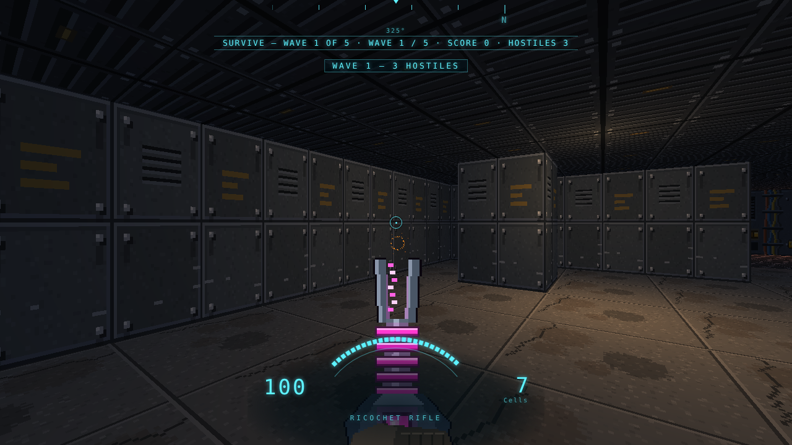

<div align="center">

# BULKHEAD

**A browser game engine for rapid prototyping, written in strict TypeScript.** A small plugin kernel, a public SDK,
genre templates, live and state-preserving hot reload, an in-game inspector and agent tooling. It ships with
around 40 playable presets (shooter, metroidvania, roguelite, racing, tactics, adventure, 3D puzzle, tower defense,
cards, RPG and more) that are built only from that SDK.

[](https://github.com/mojomast/fpsrizz/actions/workflows/ci.yml)


-brightgreen)


### [▶ Play it in your browser](https://mojomast.github.io/fpsrizz/)

**Direct:** [Hollowmere metroidvania](https://mojomast.github.io/fpsrizz/?preset=hollowmere/ascent) · [Cinder Vault](https://mojomast.github.io/fpsrizz/?preset=cinder/vault) · [Bulkhead Station](https://mojomast.github.io/fpsrizz/?preset=core/default)


</div>

> The public demo is whatever was last deployed to GitHub Pages. Newer presets (for example `sandbox/navmesh`) appear
> there after the manual **Deploy to GitHub Pages** workflow runs. Locally, `npm run dev` always runs the current code.

---

## What it is

Bulkhead is a **small runtime kernel that knows no game concepts**, plus **plugins for everything else**. A game is a
JSON *preset*: a list of plugins, role selections (camera, controller, HUD, mode and so on) and config. Every bundled
game, including the reference FPS "Bulkhead Station", uses the same public SDK a third party would use, so adding a
weapon, an enemy, a HUD, a mechanic or a whole game never means editing the engine.

- **Kernel** (`@bulkhead/kernel`): plugin host, scopes, ECS with cached queries, a fixed-step 60 Hz scheduler, typed
  registries, command and event buses, snapshots. No DOM.
- **SDK** (`@bulkhead/sdk`, version 3.0.0): the only thing plugins import. It covers core APIs, contracts (game
  vocabulary, physics, navmesh, input, audio, assets, scenes, mechanics) and the rendering surface.
- **Platform** (`@bulkhead/platform-web`): browser adapters for input (keyboard, mouse, gamepad, touch), Web Audio,
  storage, UI and the Three.js render host.
- **Standard plugins** (`@bulkhead/std`): transform/render sync, Rapier physics, Recast navmesh, glTF assets,
  prefabs and scenes, reusable mechanics (resources, actions, clocks, inventory, crafting, progression, platforming,
  navigation and more), presentation and themes.
- **Games** (`games/<family>/`): each family keeps its own plugins, family-only contracts, presets, tests and docs.

Safety by construction: manifests are validated before any plugin code is imported. Registration and content are
staged and committed only if everything validates, so a bad preset leaves the running game untouched. Every resource
is owned by a scope and disposed in reverse order, so restarts and preset switches do not leak.

## Quick start

Requires **Node ≥ 22.18** (`nvm use` reads `.nvmrc`) and a WebGL2 browser.

```bash
git clone https://github.com/mojomast/fpsrizz && cd fpsrizz
npm ci
npm run dev                                   # http://127.0.0.1:5173/  (agent bridge on :5174)
```

### Make a game from a template

```bash
npm run bulkhead -- create my-game --template fps    # or platformer | topdown | puzzle | cards | blank
npm run dev                                          # open http://127.0.0.1:5173/?preset=my-game/default
```

This adds `games/my-game/`, which contains a plugin, a preset, headless tests and an `AGENTS.md` for coding agents.
Outside a checkout, `npm create bulkhead@latest my-game -- --template fps` (the unscoped
[`create-bulkhead`](https://www.npmjs.com/package/create-bulkhead) package) clones the engine release `v0.1.0` into
`./my-game`, installs it and scaffolds the game there. More commands:
`npm run bulkhead -- templates | new plugin | add | validate | graph` ([CLI guide](docs/guide/bulkhead-cli.md),
[create a game](docs/guide/create-a-game.md)).

## The dev loop

| Tool | How | Docs |
|---|---|---|
| **Live and hot reload** | `npm run dev` rebuilds on save and reloads. For all-SDK-3 presets the run's snapshot survives the reload, so you keep your place. Config tweaks restart with state kept. `?seed=N` pins randomness. | [inspector](docs/reference/inspector.md) |
| **Inspector** | Press `` ` `` and open **Inspect**: entity list, live component editor, config tweaks with **Export preset**, and hold/step/speed time controls. | [inspector](docs/reference/inspector.md) |
| **Debug draw** | `debugDraw(ctx).line/box/sphere/text` from any plugin. Turn it on with `?debugdraw` or the Inspect tab. It also outlines colliders and navmeshes. | [inspector](docs/reference/inspector.md) |
| **Perf HUD** | **F3** or `?perf`: FPS, CPU and GPU ms, draws, entities, renderer backend and the slowest systems. Also per-system timings JSON, `npm run perf` budgets and an optional CI job. | [performance](docs/guide/performance.md) |
| **Agents** | The JSON-RPC dev protocol (`world.query`, `entity.get/set`, `sim.step`, `input.press`, `preset/config`, `replay.run`, `screenshot` and more) starts with `npm run dev`. `npm run mcp` exposes it as a stdio MCP server. `npm run find-reuse` searches existing capabilities. See [AGENTS.md](AGENTS.md) and [llms.txt](llms.txt). | [dev protocol](docs/reference/dev-protocol.md) |
| **Gallery** | `/gallery/` (linked from the start screen) lists every plugin, recipe and SDK contract, with **Play** links to presets that use them. It is generated from the reuse index. | [reuse](docs/guide/reuse.md) |
| **Schemas** | JSON Schemas for manifests, presets, content packs, scenes, replays and snapshots give editor completion and are checked in `npm run check`. | [schemas](docs/reference/schemas.md) |

## Engine features

| Area | What you get | Docs |
|---|---|---|
| ECS and queries | `world.query({ with, without })` with added, removed and changed tracking; `markChanged` | [queries](docs/reference/queries.md) |
| 3D transforms | `Transform3D`, hierarchy, interpolated render sync, `Renderable` shapes, models and instancing | [spatial](docs/reference/spatial.md) |
| Physics | `std/physics-rapier`: bodies, colliders, sensors, raycasts and a character controller. Lazy WASM chunk | [physics](docs/reference/physics.md) |
| Navmesh | `std/navigation-recast`: Recast/Detour navmesh built from colliders or triangles, `NavAgent` steering. Grids and graphs use `mechanics/navigation` | [navmesh](docs/reference/navmesh.md), [navigation](docs/reference/navigation.md) |
| Assets | `Assets` service, manifest `preload`, glTF with Meshopt and KTX2 decode, glTF extras mapped to components, `npm run assets` | [assets](docs/reference/assets.md) |
| Scenes | Data prefabs (`extends`/overrides), `*.scene.json`, Tiled and LDtk import, `spawnScene` | [scenes](docs/reference/scenes.md) |
| Input | Actions and axes, keyboard, mouse, gamepad and touch (visible virtual stick), rebinding saved to the profile | [input](docs/reference/input.md) |
| Audio | Sample registry, buses tied to settings, 3D panned voices, synth fallback | [audio](docs/reference/audio.md) |
| Saves and replays | `ctx.persist`, run snapshots with migrations, F6/F9 quicksave, `?record` + F8 `.replay.json`, replays as tests | [snapshots](docs/reference/snapshots.md) |
| Rendering | Vendored Three.js r187 WebGL2. Opt-in `?renderer=webgpu` (WebGPURenderer with WebGL2 fallback) behind a per-preset parity gate | [webgpu](docs/reference/webgpu.md) |
| Reusable mechanics | Resources, actions, clocks, objectives, inventory, crafting, progression, capabilities, platforming, room maps, sequences, command queues, deadlines | [reusable mechanics](docs/reference/reusable-mechanics.md) |

## Repository layout

```
packages/                     npm workspaces (private until the @bulkhead scope is claimed)
  kernel/src/                 @bulkhead/kernel: plugin host, ECS, scheduler, registries, buses, snapshots (no DOM)
  sdk/src/                    @bulkhead/sdk: core.ts, contracts/, render.ts (the only plugin import surface)
  platform-web/src/           @bulkhead/platform-web: input, audio, storage, UI, Three.js render host, perf HUD, touch
  std/plugins/                @bulkhead/std: shared plugins (std-*, mechanics-*, presentation-*, theme-*)
  tools/                      @bulkhead/tools: the `bulkhead` CLI bin (forwards to scripts/bulkhead.mjs)
  create-bulkhead/            `npm create bulkhead` wrapper (`create-bulkhead` on npm, clones `v0.1.0`)
games/<family>/               plugins/, contracts/, presets/, tests/ (unit + browser demos), docs, family.json
src/app/                      composition root: main.ts (frame loop), catalog, shell (menus), creator and inspector
templates/                    genre templates (templates/games/*) and the plugin starter
schemas/                      JSON Schemas for every data file
docs/                         guide/, reference/, cookbook/, design/, migrations/, games/, archive/
scripts/                      build, dev, CLI, boundary lint, reuse index, export, visual and perf tooling
tests/                        engine node:test suites, browser suites, tests/visual (Playwright goldens)
public/                       static files, art packs, models and the generated gallery
```

Import rules: plugins import only `@bulkhead/sdk` (and `@bulkhead/sdk/render.ts` with the `render` capability), plus
their own family's contracts and the contracts of families listed in `family.json` `"uses"`. `npm run lint` enforces
this ([packages](docs/reference/packages.md)).

## Testing, deploy and releases

| | Command | Notes |
|---|---|---|
| Everything fast | `npm run check` | Node preflight, catalog, assets, schemas, typecheck, boundaries, docs links, reuse index, SDK version sync, bundle budget, ~970 tests |
| Browser suites | `npm run build && npm run test:browser` | Smoke plus one demo per family, the WebGPU parity suite and more, in headless Chrome (SwiftShader) |
| Visual regression | `npm run test:visual` | Playwright goldens per template and preset. Chromium goldens are committed; Firefox/WebKit run in a non-blocking CI matrix ([visual tests](docs/guide/visual-tests.md)) |
| Perf budgets | `npm run perf -- --enforce` | Optional CI job (manual dispatch or the `perf` label) |
| itch.io zip | `npm run export:itch` | Writes `.export/bulkhead-itch.zip` and checks itch's HTML5 limits ([deploy](docs/guide/deploy.md)) |
| Deploy | Actions → *Deploy to GitHub Pages* / *Deploy to itch.io* | Manual dispatch only ([deploy](docs/guide/deploy.md)) |
| Releases | `npm run changeset`, `npm run version-packages` | Changesets. The `@bulkhead/*` group version equals `SDK_VERSION`. No release has been cut yet ([releasing](docs/guide/releasing.md), [migrations](docs/migrations/)) |

## Bundled games

The games below double as engine samples: every one is a preset you can open with `?preset=<id>` or switch to live
from **Creator tools** (`` ` ``). Family guides live in [games/README.md](games/README.md).

### Independent game experiences

Open **Creator tools → Load**, select a preset, then **Apply & restart → Play**.

| Experience | Defining loop | Controls and guide |
|---|---|---|
| **NEON RUN — Circuit Trial** | Accelerate, brake and drift a visible car through two ordered laps | W/S or ↑/↓, A/D or ←/→, Space to drift; [racing guide](games/racing/README.md) |
| **Signal Break — Turn Tactics** | Select a squad member, preview moves/attacks, spend AP, then end the turn | Cursor or keyboard, M/A for action mode, E to end turn; [tactics guide](games/tactics/README.md) |
| **The Last Light** | Explore three rooms, talk to the keeper, combine items and restore a beacon | Click or Tab/Enter; explicit chapter Save/Load; [adventure guide](games/adventure/README.md) |
| **Stonewake — 3D puzzle** | Push boulders onto seals, block pursuing golems and escape three volumetric chambers | WASD/arrows to step, Space to wait, Z undo, R retry, Q/E orbit; [Stonewake guide](games/puzzles/docs/stonewake.md) |
| **Sky Salvage — 3D courier** | Fly between floating islands, recover cargo and supply matching beacons while avoiding a storm drone | WASD/arrows or held direction buttons, E collect/deliver, Space boost, F repair; [flight guide](games/sky/README.md) |
| **Ember Bastion — 3D tower defense** | Spend scrap on towers, defend three waves, repair the core or trigger a pulse | Click 3D pads or numbered buttons, then Launch wave; [defense guide](games/ember/README.md) |
| **Verdant Relay — 3D colony restoration** | Balance water, biomass and charge to restore three relays before drought or the season ends | Select a station in 3D or its button, then collect, convert, restore or wait; [colony guide](games/verdant/README.md) |

Each consists of independent simulation, presentation, authored content and theme plugins. None enables the shooter
player, world, combat, enemies, content pack, HUD or presentation. Racing and tactics use their own camera/board
presentation; adventure uses illustrated DOM scenes, while Stonewake has lit 3D meshes, an orbiting orthographic camera
and ray-picked floor controls. These games run with a free cursor or keyboard policy, without
pointer lock. The original first-person presets retain captured mouse aiming.

#### Mechanics shared across genres

**[HOLLOWMERE — The Lantern Below](games/hollowmere/README.md)** — [play the current GitHub Pages build](https://mojomast.github.io/fpsrizz/?preset=hollowmere/ascent) — is a hand-painted side-scrolling metroidvania across twelve authored rooms. Reusable platform physics, capability-gated traversal, room-map exploration and stack inventory provide the foundation: double jump, dash, wall grip, a three-hit saber combo, down-strike pogo, focus bolts, seven enemy archetypes and a two-phase Hollow King. Beacons save progress; the game-owned field journal contains a world map, inventory, capabilities, stats and persisted options, with NPCs and a crown door in the way. Assets come from the pinned Assetrizz library: five region backdrops, terrain, seven enemy strips, character/NPC art, portraits and ornate icons. Open `?preset=hollowmere/ascent` and press Play; Esc/P opens the journal, M the map, J attacks, Space jumps, K dashes and E interacts.

**[Game composition canvas](docs/reference/game-composer.md)** is the creator-tools foundation for wiring games together. It edits versioned, layout-independent `GameGraph` JSON with plugin nodes, dependency projections and authored exclusive-role selections, compiles deterministically to the normal preset format, stages through the real host before Apply, and has an agent-friendly CLI (`npm run graph`).

**[Ten-game portfolio](docs/games/ten-game-portfolio.md)** adds ten individually selectable, authored experiences: two puzzle
campaigns, two racing trials, two tactical missions, two narrative adventures, a drone-courier route and a colony
restoration scenario. They reuse existing family rules and presentations, shared mechanics and the new optional
`mechanics/outcome-rating` provider; the guide identifies their actual differences, controls and completion routes.
Two additional small card games, [Ash & Ink and Cloud Cartographer](games/puzzles/docs/portfolio-cards.md), share the new ordered-card
piles provider while keeping their card effects, decisions and win rules independent. The puzzle and card presets also
select [optional progressive assistance](games/puzzles/docs/portfolio-assist.md), and each bundled plugin has a local README for authors.

Three further games are available as independent compositions: **[The Silt Archive](games/expeditions/docs/silt-archive.md)** is a
turn-based flooded dungeon expedition; **[The Salt Ledger](games/expeditions/docs/salt-ledger.md)** is a party RPG with tactical encounters,
quests and consequential endings; and **[Common Ground](games/expeditions/docs/common-ground.md)** is a turn-based household simulation
with residents, needs, work, relationships, an editable house lot and neighborhood projects. Each guide records its implemented scope and limits.

**[CINDER VAULT — Ashbound Roguelite](games/cinder/README.md)** — [play the current GitHub Pages build](https://mojomast.github.io/fpsrizz/?preset=cinder/vault) — adds a turn-based first-person fantasy run across three
large generated dungeon depths. Choose a vault threat with **7/8/9** (Pilgrim, Delver or Ashbound), then one of three
classes. Step one tile per action, read telegraphed intents and manage a filtered 12-stack pack with armor/charm gear,
consumables, Ember Shards, nine recipes and six weapons. The deeper wings add Ash Hounds, support Acolytes, Cinder Brutes
and behavioral elites; Wardens and the Keeper enrage below half health. Optional Assetrizz NPCs open the forge, chart the
wing, or offer the Oracle’s blood/ember bargains. `M` shows a fogged automap/tactical grid and `O` toggles an orthographic
isometric view with class avatars; `Z`/`X` rotate it, isometric WASD follows the camera, and hovering previews move/attack
AP. First-person weapons stay bottom-center with a smaller footprint. Kills grant XP and non-blocking level-up boons;
wardens open descents, the Cinder Keeper ends the run, and class mastery, best threat plus legacy embers persist. Open
`?preset=cinder/vault`, press Play; choose threat with 7/8/9 and class with 1/2/3, use WASD to step, click to attack,
Enter to end turn, I for the pack, E to talk, C to craft, M for the grid, O for isometric view, H for the field guide,
7/8/9 for boons, and V for ember pulse.

Sky Salvage, Ember Bastion and Verdant Relay use the **same resource, action, clock and objective implementations**.
Only the games' spatial rules, targets and outcomes differ. Costs/gains and cooldowns are declarative kit content;
clocks explicitly use seconds or turns. Each tower has its own shared fire-action instance. Per-consumer state is scoped,
and providers can be replaced by preset role selection without editing a game. Headless integration tests complete all
three games with both the default resource provider and an independent test implementation, comparing committed events
and final states. See [mechanics and composition](docs/reference/reusable-mechanics.md) and the
[2026-11-16 best-practice research](docs/archive/research/reusable-mechanics-2026-11-16.md).

Shared [bounded command queues](docs/reference/command-queues.md) serve Stonewake's single-command ticks and The Last Light's
batch processing. Shared [explicit-clock deadlines](docs/reference/deadlines.md) serve Sky's temporary effects and Verdant's turn
boundaries. [Resource conformance tests](docs/reference/mechanic-conformance.md) exercise both resource implementations through the
public contract. The [capability design/evidence template](docs/cookbook/reusable-capability-template.md) records the promises and
verification behind future extractions.

Two selectable building-block plugins also serve existing games:

- **[`mechanics/navigation`](docs/reference/navigation.md):** deterministic unit-edge graph reachability and canonical first
  steps, shared by Stonewake pursuit and Signal Break movement.
- **[`mechanics/sequence`](docs/reference/sequences.md):** ordered steps with finite repeated rounds, shared by NEON RUN and
  Foundry Circuit. Crossing geometry, timing and race outcomes remain in each game.

Their presets select implementations through public roles. Custom presets using the migrated game authorities need
the corresponding provider/role selections; the bundled presets already include them.

#### Find existing capabilities before adding plugins

Agents and authors can search by intent rather than remembering plugin names:

```bash
npm run find-reuse -- "stamina costs cooldowns"
npm run find-reuse -- --show recipe/resource-actions
npm run -s find-reuse -- "keyed door" --json
npm run find-reuse -- "bounded command queue"
npm run find-reuse -- "temporary effect deadline"
npm run find-reuse -- "graph shortest path"
npm run find-reuse -- "ordered steps rounds"
```

Results show scope, SDK entry points, dependencies/roles, real registrations and working examples. The generated
inventory covers every source plugin and public SDK runtime value; curated recipes cover shared mechanics, input,
rendering, storage and audio. The scaffolder suggests existing candidates and creates capability metadata for new
plugins. `npm run check` rejects stale references and broken metadata. Start with [docs/guide/reuse.md](docs/guide/reuse.md) or browse
[docs/reference/reuse-index.md](docs/reference/reuse-index.md).

### Screenshots

| | |
|---|---|
|  **Start screen** with controls and active preset |  **Projectile weapons** and hitscan |
|  **Extension: ricochet rifle** (new attack behaviour plugin) |  **Extension: data-only pack** (new map, brute enemy, scattergun) |
|  **Extensions: survival mode + replacement HUD** |  **Creator panel**: plugins, presets, import/export, debug |

### The four extension proofs

Each is a preset you can switch to live from the creator panel (press `` ` ``):

| Extension | Kind | What it demonstrates |
|---|---|---|
| `example/pack` | Data-only JSON pack | New weapon, enemy, pickup and map with **zero code** |
| `example/ricochet` | Code plugin | A new attack behaviour registered through the SDK, used by a weapon defined in data |
| `example/hud` | Code plugin | A complete replacement HUD that fully removes the original |
| `example/survival` | Code plugin | A different game mode (waves, score, win and lose) using only public services |


### How to play Bulkhead Station

For **Bulkhead Station**, click **Play** on the start screen; the browser captures the mouse (pointer lock).

**Objective:** find the override switch, then reach the green exit pad. The switch is on the north wall of the
control room (north-east of the arena). Using it unlocks the exit gate that seals the exit chamber (south-east). You
lose if your health reaches zero. Doors open and close with the Use key; the exit gate only opens through the switch.

| Action | Input |
|---|---|
| Move forward / back | `W` / `S` (or `Up` / `Down` arrow) |
| Strafe left / right | `A` / `D` |
| Aim (yaw only) | Mouse; `Left` / `Right` arrow keys also turn |
| Fire | Left mouse button or `Space` |
| Use (open door, flip switch) | `E` or `F` |
| Select weapon | `1` to `5` (weapon slot number) |
| Next weapon | `Q` or mouse wheel down |
| Previous weapon | Mouse wheel up |
| Release mouse and pause | `Esc` |
| Creator tools panel | `` ` `` (backquote) |

Mouse sensitivity, volume and render quality (pixel-ratio cap) are on the start and pause screens. The start screen lists
the active preset, the objective, the controls registered by the enabled plugins, and any enabled extensions.

### Presets and extensions

The presets in `games/*/presets/` (the shooter's in `games/shooter/presets/`) include the reference game, extensions and genre slices. The first is the default.

| Preset | Adds | Where it lives |
|---|---|---|
| Bulkhead Station — Objective (`core/default`) | The reference game | `games/shooter/plugins/core-*`, `theme/industrial` |
| Bulkhead Station — Extended arsenal (`example/extended`) | Scattergun (slot 4, data pack) and Ricochet Rifle (slot 3, new attack behaviour) | `example/pack`, `example/ricochet` |
| Bulkhead Annex — content-pack map (`example/annex`) | The Annex map, Brute enemy and scattergun from the data pack | `example/pack` |
| Survival — waves, Visor HUD (`example/survival`) | Wave-survival mode and visor HUD, plus the weapons above | `example/survival`, `example/hud` |
| Bulkhead Station — Assetrizz (`theme/assetrizz-demo`) | Reference game with Assetrizz tiles/enemies and Blender weapon renders | `theme/assetrizz` |
| Time Trial Raid (`example/time-trial`) | Find the override and escape before the deadline | `example/time-trial`, `theme/assetrizz` |
| Arena Score Attack (`example/arena-score`) | Score kills against respawning enemies; Shift sprints and Ctrl dashes | `example/arena`, `example/dash-controller`, `theme/assetrizz` |
| Silent Observatory (`example/observatory`) | Noncombat switch hunt and escape | `example/adventure-pack`, `theme/assetrizz` |
| Blackout Ward (`example/blackout`) | A darker objective map with scarce supplies and two hostiles | `example/adventure-pack`, `theme/assetrizz` |
| Holdout (`example/holdout-game`) | Reach and defend the exit zone while enemies spawn | `example/holdout`, `example/dash-controller` |
| Key Dungeon (`example/key-dungeon-game`) | Find a key, unlock the gate, and escape | `example/keys`, `example/key-dungeon` |
| Silent Relay (`example/silent-relay-game`) | Avoid stationary guards, activate the override, and escape | `example/stealth`, `example/stealth-map` |
| Seeded Gauntlet (`example/gauntlet-game`) | Clear three encounters and receive automatic run-only upgrades | `example/roguelite` |
| Foundry Circuit (`example/foundry-race`) | Drive through checkpoints in order before time expires; W accelerates, S brakes/reverses, A/D steer | `example/racing`, `example/race-track`, `mechanics/sequence` |
| Salvage Run (`example/salvage-game`) | Collect loot and extract before the timer expires | `example/extraction`, `example/extraction-map` |
| Relay Station (`example/relay-tactical`) | Objective combat with a magazine-fed carbine; 3 selects it and R reloads | `example/tactical-pack` |
| NEON RUN (`vehicle/neon-run`) | Independent overhead vehicle handling and two-lap time trial | `vehicle/racing`, `vehicle/track`, `vehicle/presentation`, `theme/arcade`, `mechanics/sequence` |
| Signal Break (`board/turn-tactics`) | Independent squad/AP board tactics, forecasts and enemy turns | `board/tactics`, `board/mission`, `board/presentation`, `theme/board`, `mechanics/navigation` |
| The Last Light (`story/last-light`) | Independent room/dialogue/inventory puzzle with explicit chapter saving | `story/adventure`, `story/chapter`, `story/presentation`, `theme/story` |
| Stonewake (`puzzle/stonewake`) | Three 3D push-puzzle chambers, pressure plates, pursuing golems, reversible turns and orbit camera | `puzzle/rules`, `puzzle/chambers`, `puzzle/presentation`, `theme/board`, `mechanics/navigation` |
| Sky Salvage (`sky/salvage`) | 3D drone cargo recovery and delivery | `sky/game`, `sky/content`, `sky/presentation`, shared `mechanics/*` |
| Ember Bastion (`ember/bastion`) | 3D tower construction and wave defense | `ember/game`, `ember/content`, `ember/presentation`, shared `mechanics/*` |
| Verdant Relay (`verdant/relay`) | Turn-based 3D colony restoration | `verdant/game`, `verdant/content`, `verdant/presentation`, shared `mechanics/*` |
| Cinder Vault (`cinder/vault`) | Turn-based three-depth dungeon roguelite with selectable threats and behavioral elites, classes, loot, pack/gear, fogged automap/grid, toggleable first-person/isometric view, NPCs/Oracle, crafting, telegraphed enemy turns, boss enrage, in-level boons and class mastery | `cinder/game`, `cinder/content`, `cinder/hud`, `dungeon/generator`, `mechanics/inventory`, `mechanics/crafting`, `mechanics/progression` |
| Hollowmere (`hollowmere/ascent`) | 12-room Assetrizz side-scrolling metroidvania with reusable platforming/capability/room-map providers, save beacons, NPCs, field journal and a two-phase boss | `mechanics/platforming`, `mechanics/capabilities`, `mechanics/room-map`, `mechanics/inventory`, `hollowmere/game`, `hollowmere/presentation`, `hollowmere/content`, `theme/assetrizz` |

To switch: press `` ` `` (or use **Creator tools** on the start or pause screen), open **Plugins & preset**, pick a preset
in the **Load** dropdown, then press **Apply & restart**. The selection is saved in `localStorage` and restored on the
next page load. Plugins can also be toggled individually, and content packs imported, from the same panel. See
[docs/guide/plugins.md](docs/guide/plugins.md) and [docs/reference/content-format.md](docs/reference/content-format.md).


### Assetrizz art

The Assetrizz preset bundles five pinned dark-sci-fi tiles, two enemy sprite strips and two generic Blender weapon
renders; remaining art and synthesized sounds derive from the industrial theme.
The Key Dungeon preset selects a fantasy Assetrizz theme with its own tiles, enemy strips and Blender weapon renders.
To regenerate the synchronous theme painters from the pinned upstream catalog and images, use Python 3 with Pillow:

```bash
python3 scripts/assetrizz.py import
# Or use an existing checkout at the pinned revision:
python3 scripts/assetrizz.py import --library /path/to/assetrizz
python3 scripts/assetrizz.py search /path/to/assetrizz/assets/manifest.jsonl enemy
```

The tool verifies the pinned manifest and PNG hashes. `scripts/assetrizz.json` records the selected keys and provenance;
the shipped images and upstream license note are in `public/assetrizz/`. Search requires the pinned manifest, and
the generated game assets need no network connection at runtime. After changing files in `public/`, restart the dev server.

The independent games add twelve curated source images across synth, voxel and watercolor directions. Their lockfile is
`scripts/experience-assets.json`; output/provenance lives in `assets/experiences/`, with generated synchronous painters
inside the three theme plugins. Reproduce with `node scripts/import-experience-assets.mjs --library /path/to/assetrizz`
or omit `--library` to fetch the pinned selection. `--check` verifies existing hashes/pixels offline. This tooling also
requires Python 3/Pillow. Source art retains the upstream note “original, generated for Kyle Durepos”; it is not
relabelled MIT. Synthesized sounds and explicitly labelled procedural fallback art are separate authored assets.

## Supported environment

- A browser with **WebGL2**. The first-person presets also need **pointer lock**. Web Audio is used for sound; without
  it the game runs silently. `?renderer=webgpu` uses WebGPU where available and falls back to WebGL2. CI drives
  Chrome for the acceptance suites and runs Firefox/WebKit visual tests as non-blocking.
- **Node ≥ 22.18** for tooling (`engines`, `.nvmrc`, `engine-strict`; `npm run check` preflights the version).
- `?test` removes the pointer-lock requirement so automated browsers can drive the game. `window.__bulkhead` is a
  debugging and automation handle, not part of the plugin API.

## Documentation

Start at [docs/README.md](docs/README.md), which maps everything:

- **Guide:** [create a game](docs/guide/create-a-game.md), [CLI and templates](docs/guide/bulkhead-cli.md),
  [plugins and the SDK](docs/guide/plugins.md), [reuse](docs/guide/reuse.md), [performance](docs/guide/performance.md),
  [visual tests](docs/guide/visual-tests.md), [deploy](docs/guide/deploy.md), [releasing](docs/guide/releasing.md).
- **Reference:** [architecture](docs/reference/architecture.md), [packages](docs/reference/packages.md),
  [spec](docs/reference/spec.md), the engine feature pages linked above, the mechanics references, and the SDK API
  generated by `npm run docs:api` (into `docs/reference/api/`).
- **Cookbook:** [edit loop](docs/cookbook/edit-loop.md), [new game family](docs/cookbook/new-game-family.md),
  [large art](docs/cookbook/large-art.md), [building blocks](docs/cookbook/building-block-plugins.md).
- **Design:** [networking](docs/design/networking.md) (a proposal; no netcode exists yet).
- **Roadmap and history:** [docs/roadmap.md](docs/roadmap.md); plans and hand-offs in [docs/archive/](docs/archive/README.md).
- **Agents:** [AGENTS.md](AGENTS.md) and [llms.txt](llms.txt).

## Known limitations

Stated plainly. The full list is in [docs/reference/spec.md](docs/reference/spec.md).

- No multiplayer: networking is a [design doc](docs/design/networking.md) only.
- GPU performance has only been measured with headless software rendering; real-device numbers still need checking.
  Native WebGPU is not covered by CI (headless runs use the WebGPURenderer's WebGL2 backend).
- Code plugins are discovered at build time and are trusted; there is no sandbox. Imported content packs live in
  memory only.
- KTX2 *encoding* in `npm run assets` is deferred (decoding works). PWA and desktop (Tauri) wrappers are deferred.
- Only `create-bulkhead` is on npm; the `@bulkhead/*` engine packages are still `private` and unpublished.
- The default theme uses procedural placeholder art and sound. Assetrizz themes replace a subset with bundled images.

## Contributing

Read [AGENTS.md](AGENTS.md) for conventions and [docs/guide/plugins.md](docs/guide/plugins.md) to write a plugin
(`npm run bulkhead -- new plugin my/plugin`, or `npm run new-plugin -- my/plugin "My Plugin"`). Search before you build
(`npm run find-reuse -- "words"`), add a changeset for package changes, and keep `npm run check` green. See
[CONTRIBUTING.md](CONTRIBUTING.md).

## License

[MIT](LICENSE)
